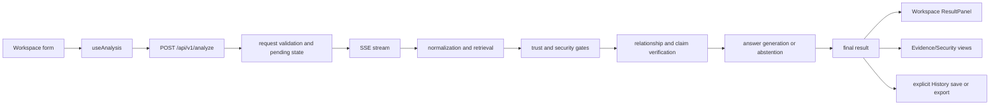
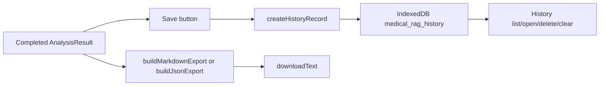

# Repository Remediation Audit and Walkthrough

Date: 2026-10-13

## 1. Executive summary

The repository is a React/Vite frontend backed by a FastAPI medical-RAG research prototype. The working tree contains the requested safety corrections and the previously missing browser-local History, Markdown/JSON export, and stateful Evidence/Security views. No Git staging, commit, push, merge, rebase, reset, clean, stash, or branch switch was performed.

The highest-risk defects found and corrected were:

- prescription confirmation used a frontend string-array shape that did not match the backend object schema;
- Additional Instructions were not consistently represented or propagated;
- normal SSE termination could create a misleading secondary error, including an authentication-shaped message;
- vision parsing accepted structurally unsafe responses and exposed raw provider content through error details;
- the Security page displayed fabricated monitoring states without a request result.

The current frontend feature set is implemented with explicit-save IndexedDB history and privacy-default exports. Evidence and Security pages consume the shared current result rather than hardcoded metrics. The full backend suite passes in the repository test mode, while three non-test-mode model-selection tests remain dependent on provider configuration and correctly fail when no credentials are available.

## 2. Repository state

| Item | Current value |
|---|---|
| Repository root | `C:\Users\sunny\.copilot\repos\copilot-worktrees\CASE STUDY\sandysunny99-bookish-meme` |
| Branch | `sandysunny99-implement-request` |
| HEAD | `91c853776ff7085faaaf25abdfbefa157dd55558` |
| Staged files | None |
| Commits created | None |
| Untracked application files | History page, history service, export service, export tests, this report |
| Preserved artifacts | Frozen experiment and historical audit artifacts were restored after test-generated changes |

The working tree intentionally contains the existing modified application files plus the new feature files. No unrelated user changes were discarded.

## 3. Runtime architecture

### Manual analysis



### Prescription-image analysis

```mermaid
flowchart LR
  A[Image upload] --> B[POST /analyze/prescription]
  B --> C[image validation]
  C --> D[vision extraction]
  D --> E[candidate_medications schema]
  E --> F[confirmation_required SSE event]
  F --> G[explicit user confirmation]
  G --> H[POST /analyze/request_id/confirm]
  H --> I[RxNorm resolution]
  I --> J[retrieval, trust, security, verification]
  J --> K[answer or controlled abstention]
```



Candidate names remain untrusted extracted text until the confirmation step. A structurally valid empty candidate list is accepted as “no detectable medications”; missing or malformed candidate data is rejected.

### User context and instructions

Patient Context and Additional Instructions enter the frontend request state, are serialized into the applicable API request, survive the pending prescription-analysis record, and are passed into live prompt construction. Additional Instructions are bounded at 2,000 characters and are explicitly treated as untrusted user data rather than policy.

### History and export



History is browser-local and explicit-save only. Prescription images are not stored. Patient Context and Additional Instructions are omitted from default exports.

## 4. Findings and fixes

| ID | Severity | Problem | Root cause | Fix | Test/evidence | Status |
|---|---|---|---|---|---|---|
| F-01 | High | Confirmation payloads could fail schema validation | Frontend sent `string[]`; backend expected medication objects | Backend normalizes string items and frontend sends compatible structured records | `tests/test_model_selector.py`; targeted backend suite | Verified |
| F-02 | High | Additional Instructions were missing from parts of the live path | Field was absent from request types, multipart handling, pending state, and prompt input | Added bounded field across schemas, routes, state, API serialization, and prompt | Full backend suite and frontend build/type checks | Verified |
| F-03 | High | Vision parser accepted unsafe response shapes | Validation only checked parseability rather than the required top-level schema | Require `candidate_medications`; reject prose-wrapped JSON and invalid candidates; allow supported whole-response fences | `tests/providers/test_vision_backend.py`: 27 targeted tests total suite | Verified |
| F-04 | High | Raw vision/provider details could leak through user-facing failures | Exception details included raw response content or `str(exception)` | Retain safe type/field metadata and emit sanitized client messages | Vision regression tests; Ruff/Bandit | Verified |
| F-05 | High | Normal SSE close could be reported as a second failure | `EventSource.onerror` was not correlated with terminal SSE events | Track terminal `error`/`complete` events and suppress duplicate disconnect handling | Frontend test suite; API implementation review | Verified |
| F-06 | Medium | Disconnects were mislabeled as authentication failures | Generic fallback error text assumed provider authentication | Use a disconnect-specific message and preserve actual terminal event state | Frontend implementation review | Verified |
| F-07 | Medium | Security page claimed active monitoring without live result data | Placeholder UI hardcoded “MONITORING” states | Render result security fields or an honest empty state | Frontend tests/build; implementation review | Verified |
| F-08 | Medium | Evidence Explorer was placeholder-only | Page was not connected to shared request state | Lift `AnalysisResult` into `App`, pass it to Evidence/Security, render source/trust/provenance fields | Frontend tests/build; implementation review | Verified |
| F-09 | Medium | History feature was absent | No persistence or navigation surface existed | Add versioned IndexedDB store, explicit save/open/delete/clear, and navigation | Export/history unit coverage; build/type checks | Partially verified |
| F-10 | Medium | Export feature was absent | No structured report generator or download action existed | Add Markdown/JSON generators with privacy-default omission and filename sanitization | `exportService.test.ts`; frontend tests | Verified |
| F-11 | Medium | Bandit configuration was malformed for the installed invocation | `.bandit` used INI syntax, while direct config loading expected YAML; CI wrapper uses `--ini` | Preserve INI for the wrapper and verify the exact configured command | `uv run bandit -r src --ini .bandit -q` | Verified |
| F-12 | Low | Non-test-mode model-selection tests fail without configured provider credentials | Availability validation intentionally distinguishes registered/configured providers from structural model validity | No fake credentials or weakened checks; test mode provides deterministic availability | `TESTING=1`: 10/10 model-selector tests; non-test mode: 3 environment-dependent failures | Environment-dependent |

## 5. File-by-file walkthrough

### Frontend application and workflow

| File | Responsibility and change | Verification/remaining work |
|---|---|---|
| `frontend/src/App.tsx` | Owns the shared current `AnalysisResult`, routes History, and opens saved records into Workspace without rerunning analysis. | Frontend tests/build pass. Browser navigation smoke testing remains useful. |
| `frontend/src/components/Layout.tsx` | Adds History to primary navigation. | Covered by build and route compilation. |
| `frontend/src/components/ResultPanel.tsx` | Adds explicit Save, Markdown, and JSON actions while retaining conclusion/model display. | Export unit tests cover pure generation; browser click/download behavior is partially verified. |
| `frontend/src/hooks/useAnalysis.ts` | Handles request lifecycle, SSE stages, terminal events, errors, Additional Instructions, and partial result updates. | Frontend suite passes. A real browser/SSE integration test remains future work. |
| `frontend/src/pages/WorkspacePage.tsx` | Captures patient context and instructions, starts manual/image requests, clears stale shared results on new analysis, and saves completed results. | Existing and new frontend checks pass. |
| `frontend/src/pages/EvidencePage.tsx` | Displays request ID, gate decision, source identity, title, excerpt, trust, provenance, PMID/DOI, and URL from the current result; shows empty state otherwise. | Current result rendering is compiled and tested indirectly; dedicated populated/empty component tests remain desirable. |
| `frontend/src/pages/SecurityPage.tsx` | Displays actual injection/poisoning states and reason, or an honest empty state. | Build and implementation review pass. |
| `frontend/src/pages/HistoryPage.tsx` | Lists saved browser-local records, opens without rerun, deletes one record, and confirmation-protects clear-all. | CRUD service and UI compile; real IndexedDB refresh behavior is not browser-tested. |
| `frontend/src/types/index.ts` | Defines the shared result contract, evidence, trust, security, claims, and optional instructions fields. | TypeScript check passes. |

### Frontend persistence and export

| File | Responsibility and change | Verification/remaining work |
|---|---|---|
| `frontend/src/services/historyDb.ts` | Version 1 IndexedDB database with `analyses` store and `createdAt` index; supports create/save/list/get/delete/clear. Copies result data and never accepts an image field. | Record construction and frontend compilation pass. Add a fake-indexeddb or browser test for upgrade/error paths later. |
| `frontend/src/services/exportService.ts` | Builds structured Markdown/JSON, preserves evidence/claims/trust/security/abstention fields, omits user context by default, and revokes download URLs. | Pure export tests pass. Download anchor behavior is not exercised in a real browser. |
| `frontend/src/services/exportService.test.ts` | Uses synthetic context markers to verify privacy defaults, explicit opt-in, abstention representation, filename sanitization, and history record construction. | 17 frontend tests pass overall. |

### Backend request and safety path

| File | Responsibility and change | Verification/remaining work |
|---|---|---|
| `src/adaptive_trust_medical_rag/api/live_schemas.py` | Adds Additional Instructions validation and preserves the live result contract. | Full backend test mode passes. |
| `src/adaptive_trust_medical_rag/api/routes/analyze.py` | Accepts instructions for manual and multipart image requests, stores them in pending state, normalizes confirmation strings, and sanitizes pipeline SSE errors. | Model/vision targeted tests pass; full test mode passes. |
| `src/adaptive_trust_medical_rag/services/live_application.py` | Receives instructions and injects them into prompt construction as untrusted content; preserves the existing trust/security/verification pipeline. | Full backend test mode passes. |
| `src/adaptive_trust_medical_rag/prompts/LIVE_APP_PROMPT_V1.txt` | Explicitly marks Additional Instructions as user-controlled data that cannot override safety, evidence, or abstention rules. | Prompt text review; no live provider claim is made. |
| `src/adaptive_trust_medical_rag/llm_backend/openai_vision_backend.py` | Strictly parses vision output, validates candidate structure, supports only whole-response JSON fences, and removes raw response content from error details. | Vision tests pass: 17 vision tests in the targeted combined run. |
| `tests/providers/test_vision_backend.py` | Adds regression cases for missing schema, embedded prose, supported fences, malformed candidates, empty extraction, malicious image text, and provider failures. | Targeted vision tests pass. |

## 6. Test evidence

Commands were run from the repository root unless noted.

| Command | Result |
|---|---|
| `$env:TESTING="1"; uv run pytest -q` | 1,210 passed, 4 skipped, 513 warnings |
| `$env:TESTING="1"; uv run pytest -q tests/providers/test_vision_backend.py tests/test_model_selector.py` | 27 passed, 1 warning |
| `Set-Location frontend; npm run test -- --run` | 3 files, 17 tests passed |
| `Set-Location frontend; npx --no-install tsc --noEmit` | Passed |
| `Set-Location frontend; npm run build` | Passed; Vite production bundle generated |
| `uv run ruff check src/ tests/` | Passed |
| `uv run bandit -r src --ini .bandit -q` | Passed |
| `gitleaks detect --source . --no-git --config .gitleaks.toml --redact --exit-code 1` | No leaks found; approximately 76.68 MB scanned |
| `git diff --check` | Passed |

### Three non-test-mode failures

Without `TESTING=1` and without provider credentials, these tests fail:

1. `test_server_side_validation_matrix`: valid NVIDIA selection is rejected as unavailable.
2. `test_analyze_request_server_validation_rejection`: structurally valid Groq selection cannot start because the provider is not configured.
3. `test_prescription_endpoint_strict_model_validation`: structurally valid NVIDIA selection cannot start because the provider is not configured.

These tests do not require live network inference; they exercise server availability policy. The implementation intentionally distinguishes a known model from a configured provider. In test mode, deterministic availability is enabled and all three pass. No fake credentials were added and production availability checks were not weakened. This is an environment-dependent limitation, not a code regression.

## 7. Safety and privacy assessment

Verified protections include:

- medication candidates remain extracted text until explicit confirmation;
- candidate schema failures are rejected rather than guessed;
- Additional Instructions cannot replace system safety, evidence, or abstention policy;
- raw model response bodies and raw pipeline exceptions are not sent to users;
- SSE terminal events are separated from transport disconnect handling;
- evidence and security UI no longer invents monitoring, trust, or source data;
- default exports omit Patient Context and Additional Instructions;
- History is local, explicit-save, and does not persist prescription images;
- configured Bandit and Gitleaks checks pass;
- no real PHI, credentials, or provider tokens were added.

Static checks do not prove clinical safety, regulatory compliance, provider correctness, or absence of all prompt-injection paths. The system remains a research prototype and must not be used for autonomous clinical decisions.

## 8. Remaining issues and status

### Verified

- Manual and prescription request contract changes.
- Explicit confirmation compatibility.
- Strict vision response validation.
- Sanitized SSE/provider/pipeline error surfaces.
- Shared result state for Workspace, Evidence, Security, History, and export.
- Privacy-default export behavior.
- Full backend test mode and frontend/build/security checks.

### Partially verified

- Real-browser IndexedDB persistence across refresh.
- Real-browser download and URL-revocation behavior.
- Visual stale-result transitions across a new request.
- Evidence rendering for every partial/failure stage.

### Blocked or environment-dependent

- Non-test-mode provider-availability acceptance tests require configured provider credentials.
- Live provider generation and live vision behavior were not claimed or tested in this environment.

### Not implemented

- Cross-browser/cloud synchronization of History.
- User-selectable retention expiry or encrypted local history.
- A dedicated UI for evidence-to-claim graph traversal.
- Automated browser end-to-end tests for upload, confirmation, History, and downloads.

## 9. Prioritized next-development plan

### P0: Add browser-level privacy and persistence tests

**Problem:** IndexedDB, confirmation dialogs, stale-result clearing, and downloads are currently covered mostly by compilation and pure-function tests.

**Files:** `frontend/src/services/historyDb.ts`, `frontend/src/services/exportService.ts`, `frontend/src/pages/HistoryPage.tsx`, `frontend/src/pages/WorkspacePage.tsx`.

**Steps:** add a browser-capable test fixture; save a synthetic result; reload; open/delete/clear; verify image/context omission; trigger both download paths; test storage rejection.

**Definition of done:** deterministic browser test covers persistence, deletion, clear confirmation, default export privacy, and error rendering.

### P1: Add explicit partial-pipeline result states

**Problem:** The result contract can contain valid evidence when a later generation or verification stage fails, but the UI does not yet distinguish all “retrieval failed” versus “later stage failed” states.

**Files:** `frontend/src/types/index.ts`, `frontend/src/hooks/useAnalysis.ts`, `frontend/src/pages/EvidencePage.tsx`, `frontend/src/components/ResultPanel.tsx`.

**Steps:** represent terminal stage and failure stage explicitly; preserve evidence arrays on later-stage errors; render the failed stage and retained evidence.

**Definition of done:** mocked SSE tests cover retrieval failure, generation failure with evidence retained, claim-verification failure, abstention, and a new-request stale reset.

### P1: Separate structural model validation from provider availability in API tests

**Problem:** The current tests combine model catalog validation and configured-provider availability, which explains the three credential-dependent failures.

**Files:** `src/adaptive_trust_medical_rag/llm_backend/model_registry.py`, `tests/test_model_selector.py`, API route tests.

**Steps:** add pure registry tests for model/provider compatibility; add explicit configured-router tests; retain one environment-gated integration test for real credentials.

**Definition of done:** structural tests pass without credentials; availability tests state their environment prerequisite; no production policy is weakened.

### P2: Improve Evidence Explorer navigation

**Problem:** Evidence is displayed as a list rather than a claim/source relationship view.

**Files:** `frontend/src/pages/EvidencePage.tsx`, `frontend/src/types/index.ts`.

**Steps:** connect `ClaimInfo.best_evidence_chunk` to evidence rows, show contradiction/support states, and display trust factors/missing factors.

**Definition of done:** each claim can identify supporting, contradictory, or missing evidence without inventing relationships.

### P3: Improve history privacy controls

**Problem:** Local history is intentionally explicit but has no retention policy or user-visible storage accounting.

**Files:** `frontend/src/services/historyDb.ts`, `frontend/src/pages/HistoryPage.tsx`.

**Steps:** add opt-in retention expiry, record size display, and a clear privacy notice; preserve versioned migrations.

**Definition of done:** users can inspect and remove local records, and migrations are tested without deleting the database.

### P4: Research-only enhancements

Provider expansion, new retrieval experiments, threshold tuning, and changes to frozen evaluation conditions require separate approval and must not be mixed into production remediation.

## 10. Beginner-friendly verification walkthrough

1. From the repository root, run `uv sync --frozen` and `cd frontend; npm ci`.
2. Start the backend using the project’s normal FastAPI command and the frontend with `cd frontend; npm run dev`.
3. In Workspace, enter synthetic medication names and optional synthetic Patient Context/Additional Instructions. Press Analyze.
4. The frontend sends the request to `/api/v1/analyze`; the backend validates it, streams stage events, normalizes medications, retrieves evidence, evaluates trust/security, verifies claims, and either releases a qualified result or abstains.
5. For an image, upload a synthetic prescription image. Vision returns candidate text. The UI must show a confirmation step; only explicit confirmation proceeds to RxNorm resolution.
6. Open Evidence Explorer to inspect the request ID, sources, excerpts, identifiers, trust, and provenance. If no current result exists, the page must say so.
7. Open Security to inspect returned injection/poisoning states. It must not claim active monitoring without a result.
8. In ResultPanel, click Save to write a copy to browser-local IndexedDB. Open History and reopen it; reopening must not rerun the model. Delete one record or use the confirmation-protected Clear all action.
9. Use Markdown or JSON export. By default, synthetic patient-context and instruction markers must not appear in the downloaded content.
10. Diagnose failures by checking the stage message and server logs, not by treating every stream disconnect as authentication failure.
11. Run the checks:

```powershell
$env:TESTING = "1"
uv run pytest -q
uv run ruff check src/ tests/
uv run bandit -r src --ini .bandit -q
Set-Location frontend
npm run test -- --run
npx --no-install tsc --noEmit
npm run build
```

12. Review `git status --short --untracked-files=all`, `git diff --check`, and `git diff --stat`. Do not stage or commit as part of this audit.
